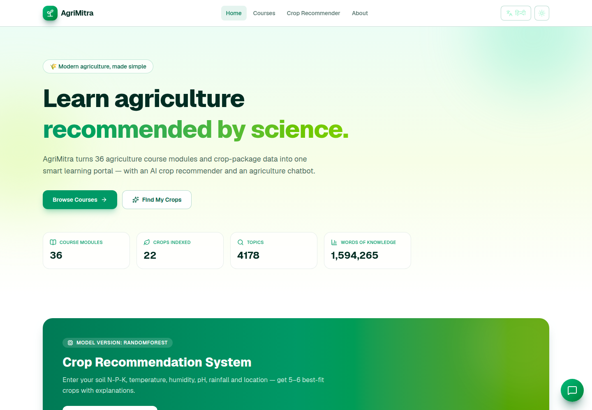
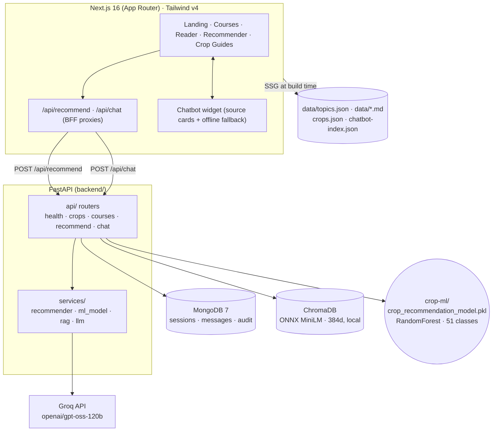
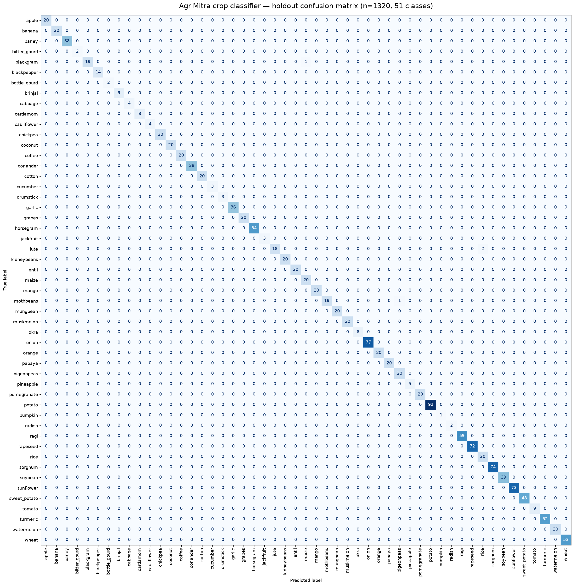

<p align="center">
  
  
  
  
  
  
  <a href="https://huggingface.co/datasets/logicmatters06/agrimitra-dataset">
    
  </a>
  <a href="https://huggingface.co/logicmatters06/agrimitra-crop-model">
    
  </a>
  <a href="https://github.com/Likeshkumarsahu/AgriMitra/actions/workflows/ci.yml">
    
  </a>
  <a href="LICENSE">
    
  </a>
</p>

# 🌾 AgriMitra

**An Agriculture Learning & Crop Recommendation Platform** — a GeeksforGeeks-style
agronomy portal that turns a 36-PDF agriculture library into searchable tutorials,
and adds an **ML-powered crop recommender** plus a **RAG chatbot** grounded in the
same knowledge base.

> Major Project · Next.js frontend + FastAPI backend · MongoDB + ChromaDB storage



## ✨ Features

| # | Feature | Detail |
| - | --- | --- |
| 1 | **Course Hub** | 36 PDFs parsed into Markdown tutorials (~1.6M words) plus structured topic guides for 16 courses (1,613 topics), SSG-rendered, searchable and filterable by 16 categories |
| 2 | **Crop Knowledge Base** | 22 crops × **15 guide sections** (basics · climate · soil · land prep · seed · sowing · irrigation · nutrients · weeds · pests · diseases · growth · monitoring · harvest · economics) |
| 3 | **Crop Recommender** | Enter **N, P, K, temperature, humidity, pH, rainfall, location** → top crops with raw model probability, a separate coverage score, and per-parameter fit bars. RandomForest with a rule-based fallback |
| 4 | **AgriBot (RAG Chatbot)** | Chat widget answers from ChromaDB chunks, shows up to **5 source cards**, and warns when an answer is not grounded in the library. Graceful keyword/offline fallback |
| 5 | **Bilingual UI** | English ⇄ हिन्दी toggle for the interface, crop names, and chatbot replies |
| 6 | **Dark / Light mode** | Persisted preference, system-aware default |
| 7 | **Resilient by design** | MongoDB down → skip persistence, keep serving. Backend down → in-browser recommender and cached chat notes. Timeouts everywhere |
| 8 | **Modular monorepo** | Next.js BFF routes, FastAPI API modules, Mongo models, services, seed scripts, ML notebooks, and a tested data pipeline |

---

## 🏗️ Architecture



### Why MongoDB **and** ChromaDB?

They store different things:

- **MongoDB** is the mutable system of record. It keeps the seeded crop catalog,
  chat sessions/messages, and recommendation audit records. If Mongo is down, the
  API still answers; persistence is skipped and logged.
- **ChromaDB** is a vector index only. It stores embedded course chunks for
  semantic retrieval. It is not the source of truth for course content.
- **`data/*.json` and `data/courses/*.md`** are build-time assets read by Next.js
  and the backend fallbacks. `public/data/` is regenerated by `npm run sync-public`
  and is intentionally not committed.

### Data flow

```text
agri-data/*.pdf
   │  scripts/extract.mjs
   ▼
data/courses/*.md ──▶ data/index.json
   │  scripts/build-crops.mjs ──▶ data/crops.json
   │  scripts/build-topics.mjs ──▶ data/topics.json
   │  scripts/build-chatbot-index.mjs ──▶ data/chatbot-index.json
   ▼
Next.js (SSG + BFF)          FastAPI
   │                            ├── RandomForest crop recommender
   │                            └── RAG: query → Chroma (top 5) → Groq
   ▼
Browser UI · recommender · chatbot with source cards
```

---

## 🧰 Tech Stack

| Layer | Technology |
| --- | --- |
| Frontend | Next.js 16 (App Router) · React 19 · TypeScript · Tailwind CSS v4 · lucide-react · react-markdown |
| Backend | FastAPI 0.141 · uvicorn · Pydantic v2 · httpx |
| Databases | MongoDB 7 (Docker) · ChromaDB 1.5 (vector) |
| AI | Groq `openai/gpt-oss-120b` · local embeddings (`all-MiniLM-L6-v2`, ONNX, 384d) · Gemini optional |
| Tooling | Node 24 · Python **3.14** · uv · Docker Compose · pytest · GitHub Actions |

> `allam-2-7b` is still available on Groq and was verified for English and Hindi,
> but its Hindi farming answers were noticeably weaker. The default is therefore
> `openai/gpt-oss-120b`; the backend also auto-detects another available chat model
> if the configured one is unreachable.

---

## 📊 Model Metrics & Provenance

The trained artifact is a scikit-learn `RandomForestClassifier` over **51 crop
labels**, using the feature order `N, P, K, temperature, humidity, ph, rainfall`.

| Metric | Value |
| --- | ---: |
| Holdout samples | 1,320 |
| Correct | 1,316 |
| **Accuracy** | **0.99697** |
| Macro precision | 0.99635 |
| Macro recall | 0.99608 |
| **Macro F1** | **0.99607** |
| Weighted F1 | 0.99696 |

The holdout is the same **80/20 stratified split** (`random_state=42`) used in
`crop-ml/trainingModel.ipynb`. Full values are in
[`docs/model-metrics.json`](docs/model-metrics.json); the 51 × 51 confusion matrix
is below (also available as
[`docs/model-confusion-matrix.png`](docs/model-confusion-matrix.png)).



Top confusions: `jute → rice` (2), `blackgram → maize` (1),
`mothbeans → pigeonpeas` (1).

> The aggregate accuracy is dominated by the larger classes. Rare classes have
> only a handful of samples, so evaluate per-class performance before relying on
> this model for a new crop. The model recommends crops only; it never prescribes
> pesticide or fertilizer doses.

### Dataset provenance

- **6,596 rows · 51 classes** in `crop-ml/merged_crop_dataset.csv`.
- The first **22 classes** (100 rows each) match the widely used public Kaggle
  Crop Recommendation dataset.
- The remaining **29 classes** are additional Indian crop records compiled for
  this project. Their exact upstream source and licence were not independently
  verified; confirm rights before redistributing the training CSV.
- The source teaching corpus (36 PDFs + 20 JSON exports) is published at
  [`logicmatters06/agrimitra-dataset`](https://huggingface.co/datasets/logicmatters06/agrimitra-dataset).

---

## 📦 Hosted Assets

| Asset | Location |
| --- | --- |
| Source code | [GitHub](https://github.com/Likeshkumarsahu/AgriMitra) |
| 36 source PDFs | [HF dataset root](https://huggingface.co/datasets/logicmatters06/agrimitra-dataset) |
| 20 JSON exports | [HF dataset `json/`](https://huggingface.co/datasets/logicmatters06/agrimitra-dataset/tree/main/json) |
| Trained model | [`logicmatters06/agrimitra-crop-model`](https://huggingface.co/logicmatters06/agrimitra-crop-model) |
| Model card | [`docs/hf-model-card.md`](docs/hf-model-card.md) |
| Dataset card | [`docs/hf-dataset-card.md`](docs/hf-dataset-card.md) |

The app does **not** need the PDFs at runtime: the generated `data/*.json` and
`data/courses/*.md` are enough for the frontend. Download the PDFs only when you
want to rebuild the datasets.

### Download the model

The 46 MB `.pkl` is gitignored. Download it into `crop-ml/` before starting the
backend if you want ML recommendations:

```bash
hf download logicmatters06/agrimitra-crop-model \
  --include "crop_recommendation_model.pkl" --local-dir crop-ml
```

If the file is missing, the backend automatically uses the rule-based recommender.

### Restore the hosted data

```bash
# PDFs -> agri-data/
hf download logicmatters06/agrimitra-dataset \
  --type dataset --include "*.pdf" --local-dir agri-data

# JSON -> data/
hf download logicmatters06/agrimitra-dataset \
  --type dataset --include "json/*" --local-dir /tmp/agrimitra-json
cp /tmp/agrimitra-json/json/*.json data/
```

Install/authenticate the HF CLI if needed:

```bash
curl -LsSf https://hf.co/cli/install.sh | bash -s
hf auth login
```

---

## 📁 Project Structure

```text
AgriMitra/
├── .github/workflows/ci.yml      # backend pytest + frontend typecheck/lint/build
├── .env.example                  # root env template (Next.js + Mongo)
├── LICENSE                       # MIT for the application code
├── README.md
├── requirements.txt              # full dev env: backend + ML + Jupyter + PDF pipeline
├── pytest.ini                    # pythonpath=backend, testpaths=backend/tests
├── agri-data/                    # 36 source PDFs (gitignored; Hugging Face)
├── crop-ml/                      # ML recipe, model, notebooks, CSV
│   ├── crop_recommendation_model.pkl  # trained RandomForest (~46 MB; gitignored)
│   ├── dataProcessing_EDA.ipynb
│   ├── trainingModel.ipynb
│   ├── testingModel.ipynb
│   ├── merged_crop_dataset.csv
│   └── processed_crop_dataset.csv
├── data/                         # generated data (JSON also mirrored on Hugging Face)
│   ├── index.json                # course index
│   ├── crops.json                # 22 crops × 15 sections
│   ├── topics.json               # structured reader topics (16 courses)
│   ├── chatbot-index.json        # RAG/keyword chunks
│   ├── courses/*.md              # extracted tutorial Markdown (fallback reader)
│   └── *_topic_level_*.json      # 16 source topic exports (mirrored on HF)
├── docs/
│   ├── model-metrics.json        # holdout metrics
│   ├── model-confusion-matrix.png
│   ├── hf-model-card.md          # source of the HF model card
│   ├── hf-dataset-card.md        # source of the HF dataset card
│   ├── hf-dataset-license.txt    # rights notice uploaded with the dataset
│   └── screenshots/home.png
├── public/data/                  # generated at dev/build time (gitignored)
├── scripts/
│   ├── extract.mjs
│   ├── build-crops.mjs
│   ├── build-topics.mjs
│   ├── build-chatbot-index.mjs
│   ├── sync-public.mjs
│   └── pdf-to-json/              # topic extractor + Ollama → structured JSON
├── src/
│   ├── app/                      # routes + BFF handlers
│   │   ├── page.tsx
│   │   ├── courses/[slug]/       # structured reader + Markdown fallback
│   │   ├── crop/[slug]/          # 15-section crop guide
│   │   ├── recommend/
│   │   └── api/{recommend,chat}/
│   ├── components/               # Navbar · Footer · Chatbot · Recommender · Reader
│   ├── lib/                      # api.ts · i18n.ts · utils.ts · server-data.ts
│   └── types.ts
└── backend/
    ├── app/
    │   ├── main.py               # FastAPI app, CORS, error envelope
    │   ├── config.py             # pydantic-settings; relative paths resolve to repo root
    │   ├── api/                  # health · crops · courses · recommend · chat
    │   ├── models/               # Mongo schemas (crop, chat, query)
    │   ├── schemas/              # request/response models
    │   ├── services/             # recommender · ml_model · rag · llm
    │   ├── db/                   # mongo.py · chroma.py (degradation-ready)
    │   └── seed/                 # seed_crops.py · ingest_docs.py
    ├── tests/                    # pytest suite
    ├── .env.example
    └── requirements.txt          # backend-only subset
```

---

## 🚀 Getting Started

### 0. Prerequisites

- **Node.js 20+** (Node 24 recommended) and npm
- **Python 3.14**
- [uv](https://docs.astral.sh/uv/) (recommended) or pip
- Docker (optional, for local MongoDB)
- A [Groq API key](https://console.groq.com/keys) for chat

### 1. Environment

```bash
# Repository root
cp .env.example .env.local

# Backend — put the real key here
cp backend/.env.example backend/.env
```

| Variable | Where | Required | Default | Purpose |
| --- | --- | :---: | --- | --- |
| `GROQ_API_KEY` | `backend/.env` | ✅ | – | Chat generation |
| `LLM_PROVIDER` | `backend/.env` | ❌ | `groq` | `groq` or `gemini` |
| `GROQ_MODEL` | `backend/.env` | ❌ | `openai/gpt-oss-120b` | Auto-detects another model if unreachable |
| `GEMINI_API_KEY` | `backend/.env` | ❌ | – | Only for Gemini chat/embeddings |
| `GEMINI_MODEL` | `backend/.env` | ❌ | `gemini-2.5-flash` | Only if `LLM_PROVIDER=gemini` |
| `EMBEDDING_PROVIDER` | `backend/.env` | ❌ | `local` | `local` (ONNX) or `gemini` (API) |
| `MONGODB_URI` | `backend/.env` | ❌ | `mongodb://localhost:27017` | Mongo connection |
| `DATA_DIR` | `backend/.env` | ❌ | `./data` | Relative paths resolve from repo root |
| `CHROMA_PERSIST_DIR` | `backend/.env` | ❌ | `./data/chroma` | Vector store path |
| `CROP_MODEL_PATH` | `backend/.env` | ❌ | `./crop-ml/crop_recommendation_model.pkl` | Empty/missing disables ML |
| `RAG_TOP_K` | `backend/.env` | ❌ | `5` | Retrieved chunks and max source cards |
| `CHROMA_MAX_DISTANCE` | `backend/.env` | ❌ | `0.75` | Drop weak vector matches |
| `CHAT_RATE_LIMIT` | `backend/.env` | ❌ | `20` | Requests per client per window |
| `CHAT_RATE_WINDOW_S` | `backend/.env` | ❌ | `60` | Rate-limit window (seconds) |
| `BACKEND_URL` | root `.env.local` | ❌ | `http://localhost:8000` | Private BFF target |
| `NEXT_PUBLIC_BACKEND_URL` | root `.env.local` | ❌ | `http://localhost:8000` | Direct backend URL |

> 🔒 **Never commit real `.env*` files.** `.env.example`, `backend/.env.example`,
> and non-secret templates are the only exceptions.

### 2. Database + vector store

```bash
# Optional local MongoDB
docker compose up -d mongo

# One environment for backend, ML, notebooks, and the PDF pipeline
uv venv --python 3.14
uv pip install -r requirements.txt
source .venv/bin/activate

# Download the ML artifact (optional; rule fallback works without it)
hf download logicmatters06/agrimitra-crop-model \
  --include "crop_recommendation_model.pkl" --local-dir crop-ml

# Seed from the repo root. PYTHONPATH makes `app` importable.
PYTHONPATH=backend python -m app.seed.seed_crops
PYTHONPATH=backend python -m app.seed.ingest_docs
```

`config.py` resolves relative `DATA_DIR`, `CHROMA_PERSIST_DIR`, and
`CROP_MODEL_PATH` against the repository root, so the same commands work from the
repo root, from `backend/`, and in CI.

### 3. Run

```bash
# Terminal 1 — FastAPI at http://localhost:8000
PYTHONPATH=backend .venv/bin/python -m uvicorn app.main:app --reload --port 8000

# Terminal 2 — Next.js at http://localhost:3000
npm run dev
```

Open **http://localhost:3000** → try the Crop Recommender or chat with **Mitra** 🌱.

The app remains usable without MongoDB or even without the backend: the frontend
falls back to local datasets and in-browser engines.

### 4. Rebuild datasets

If the source PDFs are not present locally:

```bash
hf download logicmatters06/agrimitra-dataset \
  --type dataset --include "*.pdf" --local-dir agri-data
```

Then:

```bash
npm run generate-data   # extract → crops → topics → chatbot-index → public copy
```

---

## 🧪 Tests & CI

```bash
# Backend — from the repo root
PYTHONPATH=backend .venv/bin/python -m pytest

# Frontend
npx tsc --noEmit
npm run lint
npm run build
```

The CI workflow runs the same checks on every push/PR to `main`. Backend tests use
FastAPI's `TestClient`, mock the LLM/Mongo boundary, and cover:

- required recommendation fields and range validation;
- ML/rule response contract and per-parameter scores;
- chat success, grounded sources, 503 failure, and 429 rate limiting;
- greeting/thanks edge cases, token-based keyword search, and slug links;
- `describe()` for plain, grid-search, and pipeline estimators.

The full model evaluation can be regenerated from the notebook or the committed
`docs/model-metrics.json`.

---

## 🔌 API Reference

Base URL: `http://localhost:8000`

| Method | Endpoint | Body | Response |
| --- | --- | --- | --- |
| `GET` | `/api/health` | – | `{status, services:{mongo,chroma,llm_provider,llm_configured,embedding,crop_model}, model_version}` |
| `POST` | `/api/recommend` | `{n,p,k,temperature,humidity,ph,rainfall,location,language}` | `{recommendations[{...,confidence,rawProbability,scores}], modelVersion, coverage, generatedAt, warnings}` |
| `GET` | `/api/crops` | – | 22 crops × full 15-section data |
| `GET` | `/api/crops/{slug}` | – | single crop document |
| `GET` | `/api/courses` | – | 36 course summaries |
| `POST` | `/api/chat` | `{message, language, session_id?}` | `{session_id, reply, sources[…], fallback, grounded}` |

**Error convention:** hard failures never return 2xx.

- `422` — validation error (missing/malformed/out-of-range input)
- `429` — chat rate limit; includes `Retry-After`
- `503` — LLM **and** retrieval both unavailable
- Chat with retrieved snippets but no LLM is an explicit `200` + `fallback: true`

### Recommendation engine (ML-first, rule fallback)

**Primary — RandomForest** (`modelVersion: ml-randomforest-v1`): reads N, P, K,
temperature, humidity, pH, rainfall, computes `predict_proba` over 51 labels, and
returns **raw probabilities** for the 22 guide crops. `coverage` is the percentage
of probability mass that maps to those guide crops; it is **not** renormalised to
100%. Low coverage produces a warning. Confidence = raw probability × 100 (+ the
region bonus), while `rawProbability` stays untouched for transparency.

**Fallback — rule engine** (`modelVersion: rule-based-v1`): each crop scores 0–100
per parameter, weighted **N 15% · P 10% · K 10% · Temperature 20% · Humidity 15% ·
pH 10% · Rainfall 20%**, plus a **+8 region bonus** for the selected state. Used
when the `.pkl` is missing or fails to load; the API contract is unchanged.

### RAG chain

1. Hindi/Hinglish queries are translated to English first (the local MiniLM model
   is English-only); if translation fails, the original query is used.
2. Embed locally → ChromaDB top **5** chunks → drop chunks with cosine distance
   above `CHROMA_MAX_DISTANCE` (default `0.75`).
3. If vector retrieval is empty → token-based keyword search over
   `data/chatbot-index.json` (cached index, whole-token matching).
4. Build a prompt with the retrieved chunks and ask Groq. Retrieved chunks are
   returned as **source cards** (up to 5).
5. If retrieval found nothing, the reply is marked `grounded: false` and the UI
   warns that it is not from the course library. The prompt forbids inventing
   pesticide/herbicide/fertilizer doses.
6. If the LLM fails but chunks exist → return the chunks verbatim
   (`fallback: true`). If both LLM and retrieval fail → `503`.

---

## 🎯 Future Scope

- Add 15-section guides for all 51 model classes, then widen `LABEL_TO_SLUG`.
- Soil-location autocomplete backed by a state/district table.
- Multi-turn chat memory with conversation-aware follow-ups.
- PDF export for courses and crop guides.
- Quiz engine + progress tracking (MongoDB auth).
- Weather-sensor feed adapter (moisture/pH/temp) for the recommender.
- Offline/on-prem model hosting with Ollama for deployments without API keys.

---

## ⚠️ Security Notes

- API keys live only in `backend/.env` (gitignored). The Next.js client never sees
  the backend key; the BFF keeps `BACKEND_URL` private.
- The tracked history was scanned for accidental `gsk_` and `AIza` secrets; none
  were found. If a key was ever shared in chat/logs, rotate it immediately.
- Chat requests are rate-limited per client IP in-process. For a multi-worker
  deployment, enforce a shared limit at the reverse proxy/API gateway.
- Course answers can be wrong. The UI always shows a “verify doses with a local
  expert” disclaimer, and ungrounded answers are labelled.

---

## 📄 License & Data

- **Application code:** [MIT](LICENSE).
- **Model artifact:** MIT; see the
  [model card](https://huggingface.co/logicmatters06/agrimitra-crop-model).
- **Source PDFs:** remain the property of their original authors/publishers. They
  are hosted on Hugging Face for educational/research use; verify redistribution
  rights before reusing them elsewhere.
- **Generated JSON/Markdown:** derived from the source PDFs; use responsibly and
  attribute the original sources. Project-created metadata/annotations are
  CC BY 4.0; the PDFs are excluded from that grant.
- **Training CSV:** the first 22 classes match the public Kaggle Crop
  Recommendation dataset; the additional 29 classes were compiled for this
  project. Confirm upstream rights before redistributing the CSV.
