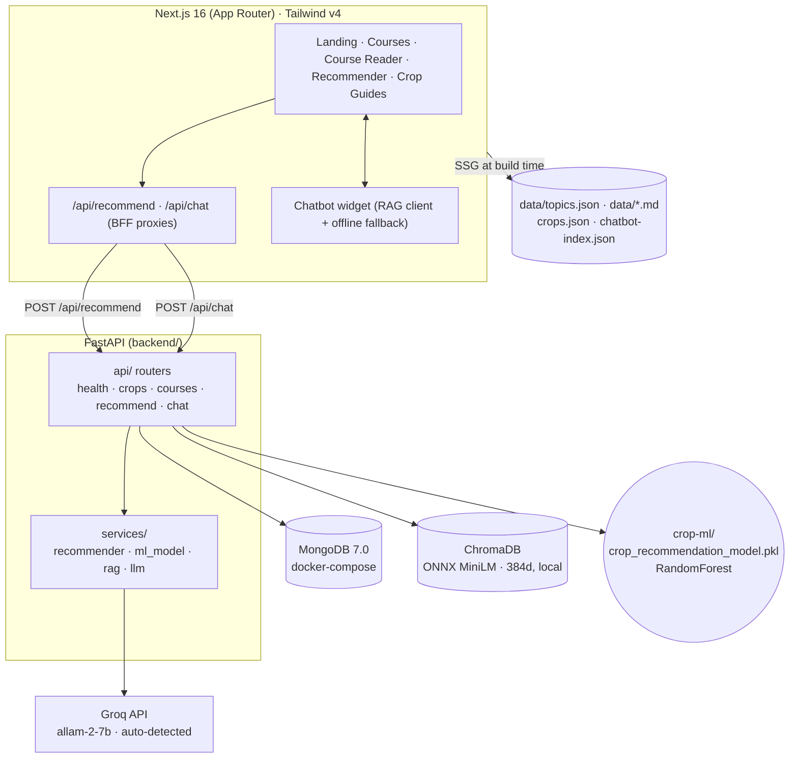

<p align="center">
  
  
  
  
  
  
  <a href="https://huggingface.co/datasets/logicmatters06/agrimitra-dataset">
    
  </a>
</p>

# 🌾 AgriMitra

**An Agriculture Learning & Crop Recommendation Platform** — a GeeksforGeeks-style
agronomy portal that turns a 36-PDF agriculture library into searchable tutorials,
and adds an **ML-powered Crop Recommendation System** (trained RandomForest) plus a
**Groq-powered RAG chatbot** grounded in the same knowledge base.

> Major Project · Next.js frontend + FastAPI (micro) backend · MongoDB + ChromaDB storage

## ✨ Features

| # | Feature                         | Detail                                                                                                                                                                                                                              |
| - | ------------------------------- | ----------------------------------------------------------------------------------------------------------------------------------------------------------------------------------------------------------------------------------- |
| 1 | **Course Hub**            | 36 PDFs auto-parsed into Markdown tutorials (~1.6M words) plus structured topic guides for 16 courses (1,613 topics), SSG prerendered, searchable & filterable by 16 categories                                                        |
| 2 | **Crop Knowledge Base**   | 22 crops × **15 horticultural sections** (basics · climate · soil · land prep · seed · sowing · irrigation · nutrients · weeds · pests · diseases · growth · monitoring · harvest · economics)                  |
| 3 | **Crop Recommender**      | Enter **N, P, K, temperature, humidity, pH, rainfall, location** → get top 5–6 crops with confidence scores. **RandomForest ML model** (trained on a 51-crop dataset, `crop-ml/`) with **rule-based fallback** |
| 4 | **AgriBot (RAG Chatbot)** | Floating chat widget. Groq generates answers (small/fast models) grounded in ChromaDB vector chunks; graceful fallback to keyword search → LLM → verbatim snippets                                                                |
| 5 | **Bilingual UI**          | English ⇄ हिन्दी toggle for the whole interface; Hindi crop names & bot replies                                                                                                                                              |
| 6 | **Dark / Light mode**     | Persisted preference, system-aware default                                                                                                                                                                                          |
| 7 | **Resilient by design**   | MongoDB down? Degrades to JSON fallback. Backend down? Recommender & chat fall back to in-browser engines. Timeouts (AbortController) everywhere                                                                                    |
| 8 | **Modular monorepo**      | Separate Next routes (BFF), FastAPI api modules, DB models, services, seed scripts, and React components                                                                                                                            |

---

## 🏗️ Architecture



### Workflow / flowgraph

```
                     ┌────────────────────────────────────────────┐
                     │              DATA PIPELINE                 │
                     │  agri-data/*.pdf  ──pdftotext──▶  data/*.md │
                     │  scripts/extract.mjs ─▶ data/index.json     │
                     │  scripts/build-crops.mjs ─▶ data/crops.json │
                     │  scripts/build-topics.mjs ─▶ data/topics.json │
                     │  scripts/build-chatbot-index.mjs ─▶ chunks  │
                     └────────────────────────────────────────────┘
                                      │
        ┌─────────────────────────────┼─────────────────────────────┐
        ▼                             ▼                             ▼
  ┌───────────────┐            ┌───────────────┐            ┌───────────────┐
  │ RECOMMEND     │            │  COURSES      │            │  CHATBOT      │
  └───────────────┘            └───────────────┘            └───────────────┘
        │ POST /api/recommend         │ SSG                      │ POST /api/chat
        ▼                             ▼                          ▼
  ┌────────────────────────────┐  ┌──────────────────┐   ┌──────────────────────────┐
  │ RandomForest ML (joblib)   │  │ topics.json + md │   │ RAG: Chroma query        │
  │ predict_proba → top 5–6    │  │ structured reader│   │   → Groq generate      │
  │ fallback: rule scorer      │  │ + md fallback    │   │ fallback: keyword → LLM  │
  │ (N,P,K,temp,hum,pH,rain,   │  │ TOC + prev/next  │   │          → verbatim      │
  │  location, region bonus)   │  └──────────────────┘   └──────────────────────────┘
  └────────────────────────────┘                         (answers grounded in the
        ▲ crop-ml/*.pkl (sklearn)              course corpus — sources
        │ + data/crops.json knowledge base                are kept server-side)
  top 5–6 crops w/ confidence + per-parameter explainer
```

---

## 🧰 Tech Stack

| Layer     | Technology                                                                                                               |
| --------- | ------------------------------------------------------------------------------------------------------------------------ |
| Frontend  | Next.js 16 (App Router) · React 19 · TypeScript · Tailwind CSS v4 · lucide-react · react-markdown                   |
| Backend   | FastAPI 0.141 · uvicorn · Pydantic v2 · httpx                                                                         |
| Databases | MongoDB 7.0 (Docker) · ChromaDB 1.5 (vector)                                                                            |
| AI        | Groq LLM (`allam-2-7b`, auto-detected) · local embeddings (`all-MiniLM-L6-v2`, ONNX, 384d) · Gemini (optional alt) |
| Tooling   | Node 24 · Python 3.14 · uv · Docker Compose                                                                           |

---

## 📦 Dataset & Hosted Assets

The source PDFs and the generated JSON exports are also published on Hugging Face:

| Asset | Location | Size |
| --- | --- | --- |
| 36 source PDFs | [Dataset root](https://huggingface.co/datasets/logicmatters06/agrimitra-dataset) | ~165 MB |
| JSON exports | [`json/` folder](https://huggingface.co/datasets/logicmatters06/agrimitra-dataset/tree/main/json) | ~16.8 MB (20 files) |
| Source code | [GitHub](https://github.com/Likeshkumarsahu/AgriMitra) | — |
| Trained model | `crop-ml/crop_recommendation_model.pkl` (local, gitignored) | ~47 MB |

The `json/` folder contains `index.json`, `crops.json`, `topics.json`,
`chatbot-index.json`, and all 16 source topic exports.

The app does **not** need the PDFs at runtime: the committed `data/*.json` and
`data/courses/*.md` are enough to run the frontend. Download the PDFs only when
you want to rebuild the datasets with `npm run generate-data`.

### Restore the hosted data

```bash
# PDFs -> agri-data/
hf download logicmatters06/agrimitra-dataset \
  --type dataset --include "*.pdf" --local-dir agri-data

# JSON -> data/
hf download logicmatters06/agrimitra-dataset \
  --type dataset --include "json/*" --local-dir /tmp/agrimitra-json
cp /tmp/agrimitra-json/json/*.json data/
```

Install and authenticate the Hugging Face CLI if needed:

```bash
curl -LsSf https://hf.co/cli/install.sh | bash -s
hf auth login
```

> `agri-data/` and `crop-ml/*.pkl` are intentionally gitignored. The model is
> regenerated from `crop-ml/trainingModel.ipynb`; if it is missing, the backend
> falls back to the rule-based recommender.

---

## 📁 Project Structure

```
🗂 AgriMitra/
├── .venv/                       # single Python environment for the whole project
├── requirements.txt             # union: backend + ML + Jupyter + pdf-to-json deps
├── agri-data/                  # 36 source PDFs (gitignored; download from Hugging Face)
├── crop-ml/                    # ML recipe: model + notebooks + training data
│   ├── crop_recommendation_model.pkl  #   trained RandomForest (~47 MB; gitignored)
│   ├── dataProcessing_EDA.ipynb       #   EDA on the merged crop dataset
│   ├── trainingModel.ipynb            #   model training (GridSearchCV)
│   ├── testingModel.ipynb             #   evaluation on a holdout set
│   ├── merged_crop_dataset.csv        #   51-crop merged dataset
│   └── processed_crop_dataset.csv     #   cleaned/feature-engineered input
├── data/                       # generated datasets (committed; JSON also mirrored on Hugging Face)
│   ├── index.json              #   course index (36 entries)
│   ├── crops.json              #   22 crops × 15 sections
│   ├── topics.json             #   structured topics for 16 courses (1,613 topics)
│   ├── chatbot-index.json      #   3621 RAG search chunks
│   └── courses/*.md            #   extracted tutorial markdown (fallback reader)
├── public/data/                # copied at build (crops + chatbot fallbacks)
├── scripts/                    # .mjs data pipeline + sync-public
│   └── pdf-to-json/            #   topic extractor + Ollama LLM → structured topic JSON
├── src/
│   ├── app/                    # routes + BFF api handlers
│   │   ├── page.tsx            #   landing
│   │   ├── courses/[slug]      #   course reader (SSG)
│   │   ├── crop/[slug]         #   15-section crop guide (SSG)
│   │   ├── recommend/          #   crop recommendation page
│   │   └── api/{recommend,chat}|   Next.js BFF proxies → FastAPI
│   ├── components/             # Navbar · Footer · Chatbot · Recommender form
│   │                           # · CourseCard · Search · MarkdownRenderer …
│   └── lib/                    # api.ts · i18n.ts · utils.ts · server-data.ts
└── backend/
    ├── app/
    │   ├── main.py             #   FastAPI app + global error handlers + CORS
    │   ├── config.py           #   pydantic-settings (env-driven)
    │   ├── api/                #   health · crops · courses · recommend · chat
    │   ├── models/             #   mongo schemas (crop, chat, query)
    │   ├── schemas/            #   request/response models
    │   ├── services/           #   recommender · ml_model · rag · llm
    │   ├── db/                 #   mongo.py · chroma.py (degradation-ready)
    │   └── seed/               #   seed_crops.py · ingest_docs.py
    ├── .env.example
    └── requirements.txt        #   backend subset of root requirements.txt
```

---

## 🚀 Getting Started

### 0. Prerequisites

- Node.js ≥ 20, Python 3.12+, [uv](https://docs.astral.sh/uv/), Docker (optional, for MongoDB)
- A [Groq API key](https://console.groq.com/keys)

### 1. Environment

```bash
# Repository root
cp .env.example .env.local     # NEXT_PUBLIC_BACKEND_URL=http://localhost:8000

# Backend — put real keys here
cp backend/.env.example backend/.env
```

| Variable                    | Where              | Required | Default                                      | Purpose                                                                          |
| --------------------------- | ------------------ | :------: | -------------------------------------------- | -------------------------------------------------------------------------------- |
| `GEMINI_API_KEY`          | `backend/.env`   |    ❌    | –                                           | Only if`LLM_PROVIDER=gemini`                                                   |
| `GROQ_API_KEY`            | `backend/.env`   |    ✅    | –                                           | LLM generation (chat)                                                            |
| `LLM_PROVIDER`            | `backend/.env`   |    ❌    | `groq`                                     | `groq` \| `gemini`                                                           |
| `GROQ_MODEL`              | `backend/.env`   |    ❌    | `allam-2-7b`                               | Groq chat model (auto-detected if unreachable)                                   |
| `GEMINI_MODEL`            | `backend/.env`   |    ❌    | `gemini-2.5-flash`                         | Gemini chat model (only if`LLM_PROVIDER=gemini`)                               |
| `EMBEDDING_PROVIDER`      | `backend/.env`   |    ❌    | `local`                                    | `local` (ONNX) \| `gemini` (API)                                             |
| `MONGODB_URI`             | `backend/.env`   |    ❌    | `mongodb://localhost:27017`                | Mongo connection                                                                 |
| `CHROMA_PERSIST_DIR`      | `backend/.env`   |    ❌    | `data/chroma`                              | Vector store path                                                                |
| `CROP_MODEL_PATH`         | `backend/.env`   |    ❌    | `../crop-ml/crop_recommendation_model.pkl` | Trained RandomForest artifact; leave unset to use the default, empty disables ML |
| `BACKEND_URL`             | root`.env.local` |    ❌    | `http://localhost:8000`                    | Private BFF target                                                               |
| `NEXT_PUBLIC_BACKEND_URL` | root`.env.local` |    ❌    | `http://localhost:8000`                    | Direct backend url                                                               |

> 🔒 **Never commit `.env*`** — exceptions: `.env.example`, `.env.local` (non-secret). Real
> `backend/.env` and root `.env` are gitignored.

### 2. Database + vector store

```bash
# (Optional) MongoDB — or set MONGODB_URI to a cloud cluster
docker compose up -d mongo

# One environment for everything (backend, ML, Jupyter, pdf-to-json)
uv venv && uv pip install -r requirements.txt      # creates ./.venv
source .venv/bin/activate

# Seed the databases (run from the repo root)
python -m app.seed.seed_crops    # → Mongo crops collection
python -m app.seed.ingest_docs   # → Chroma collection (local MiniLM embeddings, 384d, no API key)
```

> Set `PYTHONPATH=backend` when running backend code from the repo root, or `cd backend`
> and invoke the same `python` from `../.venv`.

### 3. Run

```bash
# Terminal 1 — FastAPI (http://localhost:8000)
cd backend && ../.venv/bin/python -m uvicorn app.main:app --reload --port 8000

# Terminal 2 — Next.js (http://localhost:3000)
npm run dev
```

Open **http://localhost:3000** → try the Crop Recommender or chat with **Mitra** 🌱.

> The recommender auto-loads `crop-ml/crop_recommendation_model.pkl`
> on first request (lazy). If it's missing, the API transparently falls back to the rule engine.

> The app is **fully usable without MongoDB or even without the backend** — it degrades
> to local datasets and in-browser engines so the demo never breaks.

### 4. Rebuild datasets (when agri-data changes)

If the source PDFs are not present locally:

```bash
hf download logicmatters06/agrimitra-dataset \
  --type dataset --include "*.pdf" --local-dir agri-data
```

Then rebuild the generated data:

```bash
npm run generate-data    # extract → crops → topics → chatbot-index → public copy
```

---

## 🔌 API Reference

Base URL: `http://localhost:8000`

| Method   | Endpoint              | Body                                                           | Response                                                                                                                   |
| -------- | --------------------- | -------------------------------------------------------------- | -------------------------------------------------------------------------------------------------------------------------- |
| `GET`  | `/api/health`       | –                                                             | `{status, services:{mongo,chroma,llm_provider,llm_configured,crop_model}, model_version}`                                |
| `POST` | `/api/recommend`    | `{n,p,k,temperature,humidity,ph,rainfall,location,language}` | `{recommendations[{id,slug,name,nameHi,emoji,categoryName,confidence,scores}], modelVersion, generatedAt, warnings}`     |
| `GET`  | `/api/crops`        | –                                                             | `[22 crops × full 15-section data]`                                                                                     |
| `GET`  | `/api/crops/{slug}` | –                                                             | single crop doc                                                                                                            |
| `GET`  | `/api/courses`      | –                                                             | `[36 course summaries]`                                                                                                  |
| `POST` | `/api/chat`         | `{message, language, session_id?}`                           | `{session_id, reply, sources[…], fallback}` — `sources` kept in the payload but **not rendered** in the widget |

**Error convention:** every failure returns `{ "error": "...", "message": "..." }` with a
2xx/4xx/5xx code. Validation errors → `422`. Upstream (AI/db) issues → `503`.

### Recommendation engine (ML-first, rule fallback)

**Primary — trained RandomForest** (`modelVersion: ml-randomforest-v1`): the classifier
reads N, P, K, temperature, humidity, pH, rainfall in that order, computes
`predict_proba` over its 51 crop labels, then renormalises over the 22 crops that have a
full knowledge-base guide here. Confidence = renormalised probability × 100. The
per-parameter score bars on the cards come from a small rule pass over the crop's ideal
ranges, so each pick stays explainable.

**Fallback — rule engine** (`modelVersion: rule-based-v1`): each crop scores 0–100 per
parameter (100 inside its ideal range, linear decay outside), weighted
**N 15% · P 10% · K 10% · Temperature 20% · Humidity 15% · pH 10% · Rainfall 20%**,
plus a **+8 region bonus** when the location's state matches. Total =
`weights·scores + bonus`, clamped ≤ 100. Used when `crop_recommendation_model.pkl`
is missing or fails to load — the API contract never changes. The model is
lazy-loaded from `backend/app/services/ml_model.py`.

### RAG chain (fine-grained degradation)

1. Embed query (local `all-MiniLM-L6-v2`, 384d) → ChromaDB top-k (64) → filter by score.
2. If vector retrieval empty → **keyword search** over `data/chatbot-index.json`.
3. Build prompt with ~15 top chunks → Groq (small/fast model) generates a grounded reply.
4. If generation fails → return the retrieved snippets **verbatim** (`fallback: true`).
5. Replies are grounded in the course corpus; retrieval `sources` stay server-side so the widget stays clean.

---

## 🧪 Verification

```bash
npm run lint          # eslint (0 errors)
npx tsc --noEmit      # typecheck (0 errors)
npm run build         # production build: 66 prerendered pages

# backend (run from the backend/ directory — the app package lives there)
cd backend
python -c "from app.main import app; print('ok')"
python -c "from app.services.ml_model import model_is_ready; print('ml model ready:', model_is_ready())"
curl -s localhost:8000/api/health | jq .   # crop_model should read ml-randomforest-v1
```

---

## 🎯 Future Scope

- Extend the recommender to more crops from the trained 51-class space (add their 15-section guides, then widen `LABEL_TO_SLUG` in `ml_model.py`).
- Add soil-location autocomplete backed by a state/district table.
- Multi-turn chat memory with conversation-aware follow-ups.
- PDF download for every crop guide; export course as `.pdf`.
- Quiz engine + progress tracking per user (auth via MongoDB).
- Weather-sensor live feed adapter (moisture/pH/temp) feeding the recommender.
- Edge/byte-arabic model hosting on Ollama for on-prem (no API keys).

---

## ⚠️ Security Notes

- API keys live **only** in `backend/.env` (gitignored). The Next.js client never sees them.
- The BFF proxies keep `BACKEND_URL` private to the server.
- If keys were ever shared in chat/logs, **rotate them immediately**.

## 📄 License & Data

Educational project.

- **Code:** use and adapt for learning; add an explicit license if you plan to redistribute it.
- **Source PDFs:** remain the property of their original authors/publishers. They are
  hosted on Hugging Face for educational use — verify redistribution rights before
  reusing them elsewhere.
- **Generated JSON/Markdown:** derived from the source PDFs; use responsibly and
  attribute the original sources.
